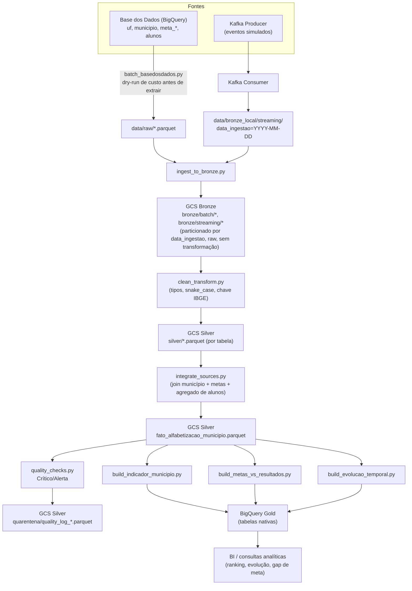

# Pipeline Híbrido para Análise da Alfabetização no Brasil

Tech Challenge — Fase 2 (Pós-Tech AI Scientist). Pipeline batch + streaming, com
arquitetura Medalhão (Bronze/Silver/Gold), sobre o **Indicador Criança
Alfabetizada** do Compromisso Nacional Criança Alfabetizada (Decreto nº
11.556/2023).

## 1. Contexto

O Compromisso Nacional Criança Alfabetizada é um programa federal que estabelece
metas de alfabetização (2024-2030) para cada município do Brasil, medidas via
avaliações estaduais de 2º ano do ensino fundamental. O desafio de negócio é
integrar múltiplas fontes públicas (resultados por município, por UF, metas
pactuadas, microdados de alunos) para permitir que gestores públicos identifiquem
municípios em risco de não atingir a meta.

Todas as tabelas usadas vêm do dataset **Avaliação da Alfabetização**
(`br_inep_avaliacao_alfabetizacao`) da [Base dos Dados](https://basedosdados.org/),
hospedado nativamente no BigQuery (projeto público `basedosdados`).

## 2. Arquitetura



**Fluxo resumido:** ingestão batch (Base dos Dados via BigQuery) + streaming
simulado (Kafka local) → Bronze no GCS (raw, particionado por data, Parquet) →
Silver (limpo, integrado, validado) → Gold (tabelas nativas no BigQuery, prontas
para BI/ML).

## 3. Tecnologias

| Camada | Ferramenta | Por quê |
|---|---|---|
| Ingestão batch | Python + `google-cloud-bigquery` (autenticação via service account) | Acesso direto às tabelas da Base dos Dados no BigQuery |
| Ingestão streaming (simulada) | Kafka (local) + `kafka-python` | Simula eventos de atualização de indicador |
| Armazenamento Bronze/Silver | Google Cloud Storage + Parquet particionado | Colunar, comprimido, permite política de retenção por partição |
| Processamento | Python + Pandas | Volume de dados (dezenas de milhões de linhas) cabe confortavelmente em memória; prazo curto favorece Pandas sobre Spark |
| Gold | Tabelas nativas no BigQuery | Pronto para consulta SQL/BI direta |
| Qualidade de dados | Funções Python customizadas, classificação Crítico/Alerta, log de quarentena | Framework completo (Great Expectations) consome tempo não disponível no prazo |
| Testes | `pytest` | Cobertura das funções de `quality_checks.py` |

## 4. Trade-offs e decisões

- **Kafka standalone em vez de Docker Compose**: a máquina de desenvolvimento é
  corporativa e a instalação do Docker Desktop exigiria WSL2 + reinício +
  aprovação de TI (licenciamento Docker Business). O `docker-compose.yml` está no
  repositório e funciona em qualquer ambiente com Docker disponível; nesta
  máquina específica, Zookeeper + Kafka 2.8.2 rodam como processos Java nativos
  (única versão do Kafka com broker compatível com Java 8, já presente na
  máquina).
- **Filtro de rede Municipal (`rede='3'`) na camada Gold**: a tabela `municipio`
  traz múltiplas redes de ensino por município/ano, mas o programa mede
  especificamente a rede Municipal. O código foi confirmado empiricamente
  (comparando contra `meta_alfabetizacao_municipio`, que é exclusivamente
  municipal) antes de aplicar o filtro — não foi assumido.
- **Join Silver por `id_municipio + ano` (sem `rede`)**: a tabela de metas usa o
  texto `'Municipal'` como valor de `rede`, enquanto `municipio` usa códigos
  numéricos — vocabulários incompatíveis entre tabelas da própria fonte. Isso foi
  descoberto pelo próprio `quality_checks.py` (100% de nulos nas colunas de meta
  após o join incorreto) antes de ir para produção.
- **Pandas em vez de PySpark**: dataset cabe em memória (maior tabela, `alunos`,
  tem ~3,9M linhas / 68 MB em Parquet); Spark adicionaria complexidade
  operacional sem ganho de performance neste volume.
- **Validações customizadas em vez de Great Expectations**: prazo de uma semana
  não comporta a curva de aprendizado do framework; as checagens pedidas
  (duplicidade, nulos, chave, consistência) são implementáveis diretamente em
  Pandas com mesma cobertura funcional.
- **Data lake (GCS) para Bronze/Silver + data warehouse (BigQuery) para Gold**:
  em vez de escolher um dos dois, a pipeline usa cada um onde é mais forte.
  Bronze/Silver ficam em GCS como Parquet particionado — barato para reter
  histórico raw e dados intermediários que não precisam de SQL direto. Gold
  vai para tabelas nativas do BigQuery — formato colunar já indexado para
  consulta analítica ad-hoc e conexão com BI, sem exigir um engine de query
  separado sobre o lake. O custo de mover Gold para o warehouse é irrelevante
  aqui (poucos MB, seção 5), então o trade-off é puramente a favor de
  performance de consulta na camada que efetivamente é consultada com
  frequência.

## 5. FinOps e Monitoramento

Custo real medido para uma execução completa (todos os municípios, 2 anos):
**R$ 0,00** — dentro do free tier do GCP (1 TB de consultas BigQuery/mês, 5 GB de
armazenamento GCS/mês). Mesmo projetando execução mensal por um ano inteiro, o
custo projetado continua R$ 0,00 (BigQuery usaria ~0,3% da cota gratuita mensal).

Detalhamento completo, incluindo o ponto de atenção sobre retenção de partições
Bronze em cadência diária, está em [`docs/estimativa_custos.md`](docs/estimativa_custos.md).

**Monitoramento**: cada módulo (`ingestion`, `bronze`, `silver`, `gold`) usa um
logger estruturado comum (`src/utils/logging_config.py`), emitindo timestamp,
nível e origem a cada etapa — volume de linhas processadas, sucesso/falha de
escrita no GCS/BigQuery, e cada achado de qualidade classificado (`quality_checks.py`
loga Crítico/Alerta por checagem, além de persistir o log de quarentena em
`silver/quarentena/`). Isso cobre o essencial para depuração manual (falha de
ingestão, volume, alertas de qualidade) neste projeto solo de curto prazo; um
dashboard de observabilidade (latência histórica, alertas automáticos) é a
evolução natural, mas fora do escopo de tempo — os logs estruturados já
permitem plugar em uma ferramenta como Cloud Logging sem mudança de código.

## 6. Aplicação em IA

A camada Gold (`indicador_municipio`, `metas_vs_resultados`, `evolucao_temporal`)
foi desenhada como base para um modelo preditivo: usando a série temporal por
município (`evolucao_temporal`) e features como nível de alfabetização atual,
distância da meta (`gap_meta_2030`) e taxa de participação, é possível treinar um
classificador de risco ("município tende a não atingir a meta do próximo ano?")
para priorizar apoio técnico/financeiro do MEC aos municípios mais distantes da
trajetória esperada — hoje respondido só via ranking manual (seção 3 do plano de
queries), mas naturalmente extensível para um modelo supervisionado.

## 7. Estrutura do repositório

Ver [`docs/PLANO.md`](docs/PLANO.md) para o cronograma completo e
[`docs/CLAUDE.md`](docs/CLAUDE.md) para as regras fixas do projeto (particionamento,
segurança, convenções).

## 8. Como rodar

```bash
pip install -r requirements.txt
cp .env.example .env  # preencher com credenciais reais (nunca commitar o .env)

python -m src.ingestion.batch_basedosdados      # Dia 1: extrai 6 tabelas da Base dos Dados
python -m src.ingestion.kafka_producer          # Dia 2: simula eventos (requer Kafka rodando)
python -m src.ingestion.kafka_consumer
python -m src.bronze.ingest_to_bronze           # Dia 2: batch + streaming -> GCS Bronze

python -m src.silver.clean_transform            # Dia 3: Bronze -> Silver (limpo)
python -m src.silver.integrate_sources          # Dia 3: join município + metas + alunos
python -m src.silver.quality_checks             # Dia 3: valida, gera log de quarentena

python -m src.gold.build_indicador_municipio    # Dia 4: Silver -> Gold (BigQuery)
python -m src.gold.build_metas_vs_resultados
python -m src.gold.build_evolucao_temporal
```
